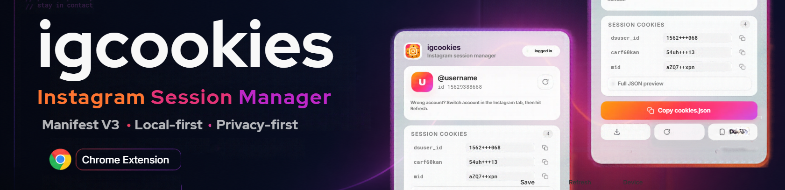

<div align="center">




<br/>

[](https://www.npmjs.com/package/@alaminnna/ica-unofficial)
[](https://www.npmjs.com/package/@alaminnna/ica-unofficial)
[](./LICENSE)
[](https://nodejs.org/)
[](#-introduction)

**Interact with Instagram programmatically — built for bot developers.**

🔐 Login & sessions · ⚡ Realtime events · 📸 Stories & media · 🧩 Pure JavaScript · 🛡️ Zero native binaries

[**Install**](#-installation) · [**Quick Start**](#-basic-usage) · [**npm**](https://www.npmjs.com/package/@alaminnna/ica-unofficial) · [**Issues**](https://github.com/alaminnna/ica-unofficial/issues)

</div>

---

<table align="center">
<tr>
<td align="center" width="25%">
<h3>🔐 Login</h3>
<sub>Credentials, cookies<br/>or AppState session</sub>
</td>
<td align="center" width="25%">
<h3>⚡ Realtime</h3>
<sub>Polling, MQTT, realtime<br/>event listeners</sub>
</td>
<td align="center" width="25%">
<h3>📸 Media</h3>
<sub>Photo, video, reel,<br/>story uploads & downloads</sub>
</td>
<td align="center" width="25%">
<h3>🧪 Pure JS</h3>
<sub>No native build step,<br/>no compiled binaries</sub>
</td>
</tr>
</table>

> I maintain this to keep Instagram bot building simple in Node.js. Small win by small win — clearer logs, stable sessions, and reliable DM automation. — **Al A Min**

**ica-unofficial (`@alaminnna/ica-unofficial`)** is an unofficial Instagram Chat API for Node.js, FCA-style. It emulates an Instagram session to automate chat on a user account — login, send & receive messages, manage threads, stories, uploads, and listen to events.

<sub>**Keywords:** instagram chat api nodejs · instagram bot api · unofficial instagram messenger api · instagram dms api · ica-unofficial · instagrapi nodejs · private instagram api · alaminnna</sub>

<details>
<summary><b>📑 Table of Contents</b> — click to expand</summary>

<br/>

- [✨ What's New](#-whats-new-in-ica-unofficial)
- [📦 Installation](#-installation)
- [⚠️ Important Disclaimer](#️-important-disclaimer)
- [🔍 Introduction](#-introduction)
- [🚀 Basic Usage](#-basic-usage)
- [📝 Message Types](#-message-types)
- [💾 Saving AppState to Avoid Re-login](#-saving-appstate-to-avoid-re-login)
- [👂 Listening for Messages](#-listening-for-messages)
- [📋 Logging](#-logging)
- [🎯 Quick Reference](#-quick-reference)
- [🙏 Credits](#-credits)
- [👨‍💻 Author — Al A Min (Alaminnna)](#-author--al-a-min-alaminnna)

</details>

<div align="center">

</div>

## ✨ What's New in ica-unofficial

<sub>**2.9.1 — realtime security & leak hardening**</sub>

| | Change |
| :-- | :-- |
| 🛡️ | **MQTT realtime fixes** — concurrent reads (keepalive ping vs read loop) no longer corrupt the stream; socket errors no longer crash the process; a dropped connection can no longer freeze the listener; 8MB packet-size cap; TCP keepalive. |
| 🧠 | **Memory leaks fixed** — unbounded maps (`systemEmitted`, `snapshots`), leaked spinner/pulse interval timers, and the listening store now auto-prune while listening. |
| 🤖 | **Handler isolation** — a throwing bot callback can no longer break packet dispatch or trigger reconnect storms (polling included). |
| 🔄 | **Auto-update on login** — every `login()` checks npm for a newer release and auto-installs it (see below). |

<sub>**2.9.0 — stability & session overhaul**</sub>

| | Change |
| :-- | :-- |
| 🔐 | **Session hardening** — AppState / cookie-based login with persistent sessions, bounded reconnect with exponential backoff, and always-resolving listener stop. |
| ⚡ | **Realtime listening** — polling, MQTT, and realtime event transports for DMs, thread events, and story updates. |
| 📸 | **Media pipeline** — photo, video, reel, IGTV and story uploads/downloads with validation and thumbnail handling. |
| 🧵 | **Threads & DMs** — send text/media/reactions, edit/unsend messages, group threads, requests, and rooms. |
| 🧩 | **Pure JavaScript** — no native build step, no compiled binaries, works with `better-sqlite3` and `sharp` as optional deps. |
| 📚 | **Docs** — examples, tests, and inline docs across `src/`. |

## 🔄 Auto-Update (new in 2.9.x)

Every `login()` automatically checks the npm registry for a newer release of
`@alaminnna/ica-unofficial`. When one exists it runs
`npm install @alaminnna/ica-unofficial@latest` **before** logging in, prints a
notice, and continues — restart the process afterwards to run the new version.
The check result is also available on the client:

```js
const api = await ica.login({ username, password });
console.log(api.lastUpdateCheck); // { checked, current, latest, updateAvailable, installed }
```

Defaults: check at most every 6h, 8s registry timeout, 3min install cap.
Never throws — a registry or install failure only logs and login proceeds.
Disable or tune it:

```js
await ica.login({ username, password, skipUpdateCheck: true }); // or autoUpdate: false
```

```bash
ICA_SKIP_UPDATE_CHECK=1   # env kill-switch (CI / Docker images)
ICA_AUTO_UPDATE=0         # check + notice only, never install
```

<div align="center">

</div>

## 📦 Installation

```bash
npm install @alaminnna/ica-unofficial
```

> **Requirement:** Node.js **>= 14** (enforced via `engines`). For reproducible installs, commit `package-lock.json` and use `npm ci`.

<details>
<summary><b>Using another package manager?</b></summary>

<br/>

```bash
# yarn
yarn add @alaminnna/ica-unofficial

# pnpm
pnpm add @alaminnna/ica-unofficial

# bun
bun add @alaminnna/ica-unofficial
```

</details>

## ⚠️ Important Disclaimer

> **We are not responsible if your account gets banned for spammy activity**, such as:
>
> - Sending lots of messages to people you don't know
> - Sending messages very quickly
> - Sending spammy-looking URLs
> - Logging in and out very quickly

**Recommendation:** Pace your requests and use sessions responsibly. Instagram may rate-limit or challenge logins from automation.

**Support:** Open an issue [here](https://github.com/alaminnna/ica-unofficial/issues).

## 🔍 Introduction

Instagram does not offer a public chat API for user accounts.

`ica-unofficial` lets you automate chat on an **Instagram user account** by emulating the app/browser session. This means:

| | |
| :-- | :-- |
| ✅ | Makes the same requests as the Instagram app |
| 🚫 | Does **not** work with generic access tokens |
| 🔑 | Requires Instagram account credentials (username/password) or a saved session/AppState |

## 🚀 Basic Usage

### 1 · Login and echo bot

```javascript
const ICA = require("@alaminnna/ica-unofficial");

const client = new ICA({
  username: "your_username",
  password: "your_password",
});

await client.login();

client.listen((err, event) => {
  if (err) return console.error(err);

  // Echo back the received message
  if (event.type === "message" && event.body) {
    client.sendText({ threadId: event.threadID, text: event.body });
  }
});
```

### 2 · Send a text message

```javascript
const ICA = require("@alaminnna/ica-unofficial");

const client = new ICA({
  username: "your_username",
  password: "your_password",
});

await client.login();

const threadId = "000000000000000"; // Replace with the actual thread ID

client
  .sendText({ threadId, text: "Hey! from ica-unofficial" })
  .then(() => console.log("Message sent successfully!"))
  .catch((err) => console.error("Send Error:", err));
```

### 3 · Send media (photo/video/reel)

```javascript
const ICA = require("@alaminnna/ica-unofficial");
const fs = require("fs");

const client = new ICA({
  username: "your_username",
  password: "your_password",
});

await client.login();

const threadId = "000000000000000";
const imagePath = __dirname + "/image.jpg";

if (!fs.existsSync(imagePath)) {
  console.error("Image file not found!");
  return;
}

client
  .sendMedia({ threadId, attachment: fs.createReadStream(imagePath) })
  .then(() => console.log("Media sent!"))
  .catch((err) => console.error("Media Send Error:", err));
```

<div align="center">

</div>

## 📝 Message Types

| Type | Usage |
| :-- | :-- |
| **Regular text** | `{ text: "message text" }` |
| **Sticker** | `{ sticker: "sticker_id" }` |
| **File / Image** | `{ attachment: fs.createReadStream(path) }` |
| **Reaction** | `{ reaction: "❤️", messageId: "..." }` |

## 💾 Saving AppState to Avoid Re-login

Save your session after the first login so you don't need to re-enter credentials:

```javascript
const fs = require("fs");
const ICA = require("@alaminnna/ica-unofficial");

const client = new ICA({
  username: "your_username",
  password: "your_password",
});

await client.login();

try {
  const session = client.getSession(); // or AppState equivalent
  fs.writeFileSync("session.json", JSON.stringify(session, null, 2));
  console.log("✅ Session saved successfully!");
} catch (error) {
  console.error("Error saving session:", error);
}
```

Reuse it on next start:

```javascript
const fs = require("fs");
const ICA = require("@alaminnna/ica-unofficial");

const session = JSON.parse(fs.readFileSync("session.json", "utf8"));

const client = new ICA({ session });
await client.login();
console.log("✅ Logged in with saved session!");
```

## 👂 Listening for Messages

### Echo bot with a stop command

```javascript
const fs = require("fs");
const ICA = require("@alaminnna/ica-unofficial");

const session = JSON.parse(fs.readFileSync("session.json", "utf8"));

const client = new ICA({ session });
await client.login();

const stopListening = client.listen((err, event) => {
  if (err) {
    console.error("Listen Error:", err);
    return;
  }

  switch (event.type) {
    case "message":
      if (event.body && event.body.trim().toLowerCase() === "/stop") {
        client.sendText({ threadId: event.threadID, text: "Goodbye…" });
        stopListening();
        return;
      }
      client.sendText({ threadId: event.threadID, text: `BOT: ${event.body}` });
      break;

    case "event":
      console.log("Event Received:", event);
      break;
  }
});
```

### Listener options

```javascript
client.setOptions({
  listenEvents: true,  // receive thread/join/leave events
  selfListen: false,   // ignore messages sent by yourself
  logLevel: "info",    // silent / error / warn / info / verbose
});
```

## 📋 Logging

Boot, session, MQTT/polling and request status lines go through one styled logger:

```text
08:14:02 ✔ OK     ica-unofficial v2.9.0 ready
08:14:03 ℹ INFO   Logging in...
08:14:05 ⚠ WARN   [setOptions] Unrecognized option given to setOptions: foo
08:14:06 ✖ ERROR  Request failed, retrying...
08:14:09 · DEBUG  [parseAndCheckLogin] {"req":1}
```

Control the level with env or runtime:

```javascript
client.setOptions({ logLevel: "debug" });
```

```bash
ICA_LOG_LEVEL=debug node index.js
```

## 🎯 Quick Reference

```javascript
client.login();                                            // start session
client.sendText({ threadId, text });                       // send a message
client.sendMedia({ threadId, attachment });                // send photo/video
client.setMessageReaction({ emoji, messageId });           // react to message
client.editMessage({ messageId, text });                   // edit a message
client.unsendMessage({ messageId });                       // unsend a message

client.getThreadInfo(threadId);                            // thread info
client.getUserInfo(userId);                                // user info

client.listen((err, event) => { /* handle DMs/events */ }); // realtime listener
client.stopListening();                                    // stop listener
```

Every module in `src/` maps to a client method (see [`index.js`](./index.js)).

## 📚 Projects Using This API

ica-unofficial works for any Instagram automation or DM bot project. Build your own Instagram bot, or integrate the API wherever you need programmatic chat.

## 🙏 Credits

Built on open-source foundations:

- **FCA-style** design inspired by Facebook Chat API patterns, adapted for Instagram.
- Thanks to the open-source community for the underlying HTTP/cookie/session patterns.

## 🤝 Contributing

Contributions are welcome!

```bash
# 1. Fork the repository, then:
git checkout -b feature/AmazingFeature
git commit -m "Add some AmazingFeature"
git push origin feature/AmazingFeature
```

Then open a Pull Request. 🚀

## 📄 License

**MIT License** — see [LICENSE](./LICENSE) for details.

<div align="center">

</div>

## 👨‍💻 Author — Al A Min (Alaminnna)

<div align="center">


### Al A Min — **Alaminnna**

*AI Developer · Full Stack Web Developer · Student · Entrepreneur · Open Source Builder*

📍 Dhaka, Bangladesh · 🌐 [alaminnna.ami.bd](https://alaminnna.ami.bd)


<br/><br/>

[](https://github.com/alaminnna)
[](https://www.linkedin.com/in/alaminnna/)
[](https://www.npmjs.com/~alaminnna)
[](https://medium.com/@Alaminnna)
[](https://dev.to/alaminnna)
[](https://www.youtube.com/@alaminnna)
[](https://www.instagram.com/alaminnna)
[](https://www.threads.net/@alaminnna)
[](https://www.tiktok.com/@alaminnnna)
[](https://www.pinterest.com/alaminnnnna/)
[](https://stackoverflow.com/users/33006113/alaminnna)
[](https://hashnode.com/@alaminnna)
[](https://www.producthunt.com/@alaminnna)
[](https://linktr.ee/alaminnna)
[](https://www.facebook.com/profile.php?id=61592578435860)

</div>

## ⭐ Support

If this project helps you, please give it a ⭐ on GitHub — it helps others find it.

<div align="center">

[](https://github.com/alaminnna/ica-unofficial/stargazers)

</div>

## 🔗 Links

| Resource | Link |
| :-- | :-- |
| 📦 NPM Package | [npmjs.com/package/@alaminnna/ica-unofficial](https://www.npmjs.com/package/@alaminnna/ica-unofficial) |
| 🐙 GitHub Repository | [github.com/alaminnna/ica-unofficial](https://github.com/alaminnna/ica-unofficial) |
| 🐛 Issue Tracker | [github.com/alaminnna/ica-unofficial/issues](https://github.com/alaminnna/ica-unofficial/issues) |

---

<div align="center">


*Built by **Al A Min (Alaminnna)** in Dhaka, Bangladesh.*

</div>

**Disclaimer:** This is an unofficial API and is not officially supported by Instagram. Use responsibly and comply with the [Instagram Terms of Use](https://help.instagram.com/581066165581870).
